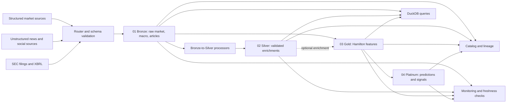

# Data Flow

Equity Lake uses four numbered medallion layers. Source identifiers are routed
by `ingestion/router.py`; destinations are mapped by `ingestion/types.py` and
written as date-partitioned Delta tables whose data files are Parquet.

Price sources are required prerequisites for feature generation. News, social,
macro, analyst, and SEC branches are optional enrichments: their failure is
recorded and the core feature path may continue without them. Bronze-to-Silver
processors are run only when their source branch is selected; their failure
disables that enrichment, not independent core features. Optional does not mean
neutral: unsupported or unverified source families remain unavailable/null and
are not silently filled with zeros.

Canonical shared keys are `(market, MIC, symbol)`; ticker text is not a global
identity. Point-in-time split-only adjustment is a read-time contract: raw
Bronze values are not adjusted in place and cash dividends are excluded.
Adjusted consumers require complete source-scoped coverage, a verified source
publication clock, and source-issued validity through the decision-session
close. The native yfinance corporate-action path does not currently provide
that complete proof, so adjusted results are unavailable until verified proof
exists; no ingestion-time clock or guessed expiry substitutes for it.

The local canonical watchlist/event/outbox workflow is auxiliary state under
`data/watchlists/` and `data/tracking/`, not a medallion/catalog branch. Tracking
and `equity signal scan` read stored data and do not refresh or backfill it.
Opportunity delivery is separate from health webhooks, disabled by default,
and has no active scheduler. ADR-0013 and ADR-0015–0018 implementations
received independent implementation/offline-contract acceptance with C10 on
2026-10-18; this is not production operational readiness.

The exact per-market outcome vocabulary, requested/produced feature coverage,
optional-failure visibility, dry-run statuses, and exit-code policy are the
contracts in [Pipeline Contracts](pipeline-contracts.md). Each requested price
market is classified once against the resolved plan date: a closed exchange is
`not_scheduled`, a planned skip that never blocks an open market, and features
and ML are planned only for the scheduled scope. The orchestrator
isolates every market's fetch/conversion/write failure (serial and parallel
alike) so one exception never erases another market's outcome. Default ticker
scope uses the ingestion configuration-key mapping, including the active
`hk` + `sg` union for `hk_sg_equity`; explicit ticker overrides are not broadened.
A fully closed HK/SG session planned-skips features and ML.

Gold feature rows use `FEATURE_SCHEMA_VERSION = 7`,
`availability_schema_version = 4`, and action-coverage proof schema version 2.
They include canonical identity, split-only adjustment version, and persisted
source action-coverage proof. The proof records its own `(market, MIC, symbol)`
identity, source, coverage interval, timezone-aware source-availability clock,
source-issued expiry, status, and proof-schema version; its identity must match
the feature row. Availability is mapped to the first observable venue session,
and expiry must reach the decision-session close. Missing or incompatible proof
makes adjusted output unavailable. Optional or unverified enrichment values
remain null with coverage/availability flags rather than neutral fills. Label
availability metadata remains part of the same versioned feature contract.
Each `next_day_return` target is computable on the next observed instrument
session; `label_available_date` records that session (ADR-0014). On a daily run
the preceding observed session's target is finalized with a bounded, label-only
Delta update, while the newest session stays pending. Training and backtests
read only labels available on or before their cutoff. Any production repair or
migration remains separately authorized and report-first/scoped.
